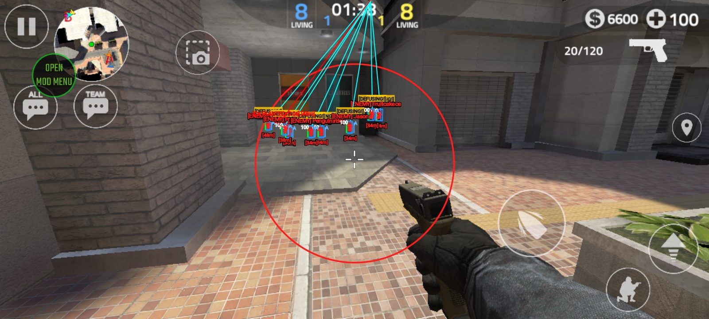

# Forward Assault - Mod Menu

Advanced Mod Menu for **Forward Assault** built with an interactive floating UI, real-time Canvas ESP overlay, customizable Aimbot, weapon loadout changer, teleport utilities, and instant bomb defuse.

---

## 📸 In-Game Preview

  

---

## 📥 Downloads

All files are located directly in the root of this repository:

| Item | Description | Password |
| :--- | :--- | :--- |
| **[`Forward_Assault_ModMenu_Installed.apk`](Forward_Assault_ModMenu_Installed.apk)** | Pre-modded Game APK (Ready to install & play) | **No Password** |
| **[`tele: @freemodder.zip`](tele:%20@freemodder.zip)** | Full Source Code (LGL Floating Menu + C++ NDK) | **Password Protected** |
| **[`dump/`](dump/)** | Complete IL2CPP Dumps (`dump.cs`, `il2cpp.h`, `script.json`, `DummyDll`) | **No Password** |

> **🔑 How to get the Source Code Password:**  
> Contact on Telegram: [**@freemodder**](https://t.me/freemodder)  
> The archive password is strictly private and available upon request.

---

## 📋 Features

### 👁️ ESP Visuals
* **ESP Line (Snaplines)**: Trace lines to enemies from Bottom, Center, or Top origin with 17 colors & thickness slider.
* **ESP Box**: 2D Box, 3D Box, Corner Box, and 2D + Filled Box with custom colors and width percentage.
* **ESP Distance**: Display enemy distance in Meters `[m]`, Feet `[ft]`, or Minimalist format.
* **ESP Health Bar**: Vertical Left, Vertical Right, Horizontal Top, Horizontal Bottom, Text HP, or Segmented Bar.
* **ESP Name**: Display enemy names (Standard, Uppercase, or Tagged `[ENEMY]`).
* **ESP Skeleton**: Real-time bone tracking (Normal Bones, Thick Bones, Head-Spine, Joints with Dots).
* **ESP Visual Outline (Chams)**: Capsule Silhouette, Full Body Glow, Cyber Wireframe, Silhouette Chams.
* **FOV Circle**: Draw customizable FOV radius (20–500), stroke thickness, colors, and styles (Dot + Circle, Glow, Dual Ring).
* **ESP Weapon Held**: Displays the current weapon held by enemies.
* **ESP C4 Bomb & Grenades**: Track planted C4 bombs and active thrown grenades.
* **ESP Dropped Weapons**: Highlight weapons dropped on the map.
* **ESP Player States**: Real-time status indicators (`[DEFUSING]`, `[RELOADING]`).
* **ESP Armor Bar**: Visual enemy armor bar and AP badges.

### 🎨 ESP Customization & Custom RGB
* **Master ESP Color**: 17 vibrant color presets.
* **Text Styling**: Outline Stroke, Drop Shadow, Dark Badge, Clean Flat, Glow Aura.
* **Text & Stroke Sizes**: Independent font size and line thickness sliders.
* **Custom RGB Color**: Direct Red (0–255), Green (0–255), and Blue (0–255) color picker.

### 🎯 Weapon Handling & Aimbot
* **Aim Stabilizer**: Eliminates weapon recoil.
* **Bullet Harmonizer**: Eliminates weapon spread (100% laser accuracy).
* **Agility Accelerator**: Boosts player movement speed and agility.
* **Target Alignment (Aimbot)**:
  * Target Bone selection: Head, Body, or Legs.
  * Aim Mode: Smooth Assist or Instant Snap.
  * Adjustable Smoothness slider.
* **Visible Check Only**: Prevents aimbot from targeting enemies behind solid walls.
* **Silent Trajectory (Magic Bullet)**: Bullets curve directly toward targets.
* **Auto Skill (Triggerbot)**: Automatically shoots when crosshair aligns with target.

### 🔄 Weapon Loadout Changer
* Instantly switch weapon loadout in-game:
  `AK-47`, `M4A1`, `AWP`, `M40 Sniper`, `Desert Eagle`, `Vector`, `P90`, `Spas-12`, `MP7`, `Karambit`, `Butterfly Knife`, `Kukri Knife`, `Frag Grenade`, `Flashbang`, `Smoke Grenade`, `C4 Bomb`.

### 💣 Tactical Throwable Teleport
* **Frag Grenade TP**: Thrown HE grenades teleport directly onto selected enemies.
* **Smoke Grenade TP**: Thrown smoke grenades teleport directly onto selected enemies.
* **Flashbang TP**: Thrown flashbangs teleport directly onto selected enemies.

### 🚀 Player Teleport
* **Teleport to Enemy**: Teleport directly behind any selected enemy.
* **Teleport to Teammate**: Teleport directly to selected teammates.
* **Teleport to Bomb Site A**: Instantly warp to Bomb Site A.
* **Teleport to Bomb Site B**: Instantly warp to Bomb Site B.

### 🎭 Weapon Skin Changer
* **Unlock All Skins**: Unlocks all premium skins in the game.
* **Skin Selector**: Over 60+ weapon skins (Wild, Volcanic, GoldDigger, Monster, Atomic, Holographic, Samurai, ShootingStars, etc.).

### ⏱️ Bomb Match Special
* **Instant Bomb Defuse**: Toggle for immediate defusal when interacting.
* **Instant Defuse Now**: One-click button in menu to defuse the bomb instantly.

---

## 💬 Contact
* Telegram: [**@freemodder**](https://t.me/freemodder)
